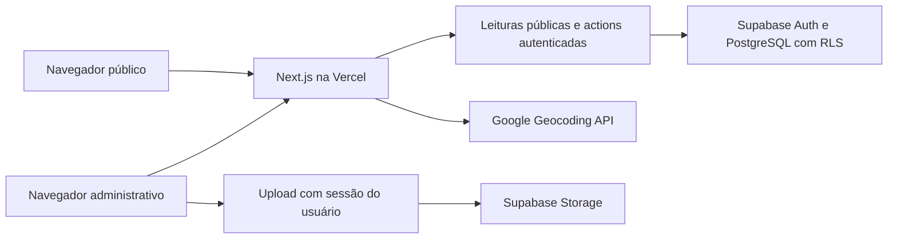

# Guia Vem Pra Torres — documentação técnica de passagem

Atualizado em **23 de outubro de 2026**. Destinado ao desenvolvedor que assumirá manutenção, evolução e operação do projeto.

## 1. Versão de referência e entrega

Repositório: <https://github.com/g4trader/guiavempratorres>.

Esta documentação descreve o código do commit **`a0016d3c57a08a50c7053dd4ea849fe68e640870`**, confirmado na `main` remota em 23/10/2026. [Consultar o código dessa versão](https://github.com/g4trader/guiavempratorres/tree/a0016d3c57a08a50c7053dd4ea849fe68e640870).

**Correções posteriores:** a branch `fix/technical-handoff`, baseada nesse commit, contém a revisão técnica descrita abaixo. Essas correções ainda não foram publicadas em produção. Responsável operacional confirmado: `contato@vempratorres.com.br`.

Esse é também o commit do último deploy de produção verificado nesta passagem de trabalho. A confirmação da `main` nesta data não equivale a uma nova auditoria das configurações dos provedores.

| Recurso                       | Identificação                                                |
| ----------------------------- | ------------------------------------------------------------ |
| Site público                  | https://www.guiavempratorres.com.br                          |
| Administração                 | https://www.guiavempratorres.com.br/admin                    |
| Vercel                        | Equipe `vem-pra-torres`, projeto `guiavempratorres`          |
| Último deployment verificado  | `dpl_5Y1JQeaq7xP7khopxRAZwc81eUU9`                           |
| URL imutável desse deployment | https://guiavempratorres-i0dl6wjch-vem-pra-torres.vercel.app |
| Supabase                      | Projeto `guiavempratorres`, ref `lcfkoltbcpaoauzlegsl`       |
| Organização Supabase          | `ljfsuuapozqveecvqwxy`                                       |
| Região Supabase registrada    | `sa-east-1`                                                  |
| GCP principal registrado      | `guiavempratorres`                                           |

**Atenção à cópia local:** na preparação desta documentação, a pasta de trabalho original estava na branch antiga `feature/cloud-supabase-foundation`, com alterações não commitadas. O release foi preparado em checkout isolado e publicado na `main`, preservando esses arquivos. Para assumir o projeto, faça um clone novo da `main`. Não use a pasta antiga como representação da produção, nem descarte suas alterações sem análise do responsável.

Os documentos operacionais foram atualizados nesta revisão. Os registros da implantação inicial foram preservados em `docs/history/`, explicitamente como histórico. Consulte também `docs/LOCAL_RECONCILIATION.md` para o inventário da pasta antiga.

## 2. Produto e funcionalidades

O sistema é um guia comercial e turístico de Torres e região, com catálogo público e painel administrativo.

- Empresas: dados comerciais, categorias, contatos, endereço, coordenadas, logo, capa, galeria, plano e destaque.
- Itens de empresas: produtos, serviços, promoções, cardápios e catálogos.
- Campanhas: criativos, período de veiculação, destinos e exibição em home, categorias e pontos turísticos.
- Pontos turísticos: listagem, página individual, localização e conteúdo em blocos.
- Usuários: autenticação pública e administrativa, recuperação de senha e papéis administrativos.
- Avaliações: nota de 1 a 5 e comentário opcional de até 150 caracteres; a action pode criar uma sessão anônima do Supabase Auth se não houver usuário autenticado.
- SEO: metadados, canonical, sitemap, robots e dados estruturados.

Planos controlam recursos e limites comerciais. Não há gateway de pagamento implementado no código examinado; não confundir cadastro de plano com cobrança recorrente.

### Rotas principais

| Rota                                                   | Responsabilidade                                                              |
| ------------------------------------------------------ | ----------------------------------------------------------------------------- |
| `/`                                                    | Campanhas, categorias, destaques, novidades e turismo                         |
| `/buscar?q=...`                                        | Busca no guia                                                                 |
| `/categorias/[slug]`                                   | Empresas da categoria                                                         |
| `/empresas/[slug]`                                     | Perfil, contatos, itens, galeria e avaliações                                 |
| `/pontos-turisticos` e `/pontos-turisticos/[slug]`     | Conteúdo turístico                                                            |
| `/entrar` e `/entrar/confirmar`                        | Login/cadastro público e confirmação                                          |
| `/admin`                                               | Entrada administrativa                                                        |
| `/admin/empresas`, `/admin/categorias`, `/admin/itens` | Gestão editorial                                                              |
| `/admin/planos`, `/admin/campanhas`                    | Gestão comercial                                                              |
| `/admin/pontos-turisticos`, `/admin/usuarios`          | Turismo e papéis                                                              |
| `/admin/redefinir-senha`                               | Redefinição de senha                                                          |
| `POST /api/admin/google-maps-location`                 | Resolução autenticada de localização                                          |
| `/demonstracao/imagens`                                | Editor demonstrativo, somente em `pnpm dev`; retorna 404 no build de produção |

## 3. Stack e arquitetura

Versões declaradas no `package.json` de referência:

| Tecnologia          | Versão           |
| ------------------- | ---------------- |
| Node.js             | 22.x             |
| pnpm                | 10.14.0          |
| Next.js / React     | 16.2.12 / 19.2.8 |
| TypeScript / Zod    | 6.0.3 / 4.4.3    |
| Supabase JS / SSR   | 2.110.9 / 0.12.3 |
| Supabase CLI        | 2.110.0          |
| Vitest / Playwright | 4.1.10 / 1.62.0  |

O Next.js App Router concentra interface e backend. Server Components carregam páginas e dados; Client Components implementam editores, carrosséis, avaliações e outras interações. Server Actions validam formulários, autorizam operações, persistem alterações e revalidam páginas. A API de localização atende o formulário administrativo.



### Mapa do código

| Diretório ou arquivo                             | Responsabilidade                                                                                        |
| ------------------------------------------------ | ------------------------------------------------------------------------------------------------------- |
| `app/`                                           | Páginas, layouts, actions e endpoints                                                                   |
| `app/admin/actions.ts`                           | Reexporta actions de `lib/data/admin-actions.ts`                                                        |
| `lib/data/content-actions.ts`                    | Empresas, categorias, galeria, campanhas, senha e papéis; reexportado em `app/admin/content-actions.ts` |
| `lib/data/tourism-actions.ts`                    | Conteúdo turístico; reexportado pela rota administrativa                                                |
| `components/admin/`                              | Formulários, editor de texto, editor de imagens, galeria e navegação                                    |
| `components/media/`                              | Molduras públicas de imagens                                                                            |
| `components/layout/Logo.tsx`                     | Renderização da marca oficial                                                                           |
| `lib/data/directory.ts`                          | Consultas públicas, busca, campanhas e resolução de URLs de imagens                                     |
| `lib/data/tourist-attractions.ts`                | Leituras públicas de turismo                                                                            |
| `lib/data/media.ts`                              | Upload autenticado no navegador                                                                         |
| `lib/supabase/`                                  | Clientes público, autenticado SSR e navegador                                                           |
| `lib/domain.ts`, `lib/validation/`, `lib/admin/` | Tipos de domínio, validações e mensagens de erro                                                        |
| `lib/media/image-layout.ts`                      | Geometria de enquadramento e exportação                                                                 |
| `lib/google-maps.ts`                             | Validação de links, coordenadas e geocodificação                                                        |
| `lib/database.types.ts`                          | Tipos do banco                                                                                          |
| `app/globals.css`                                | Tokens e estilos globais                                                                                |
| `public/brand/`                                  | Logo e favicon oficiais                                                                                 |
| `supabase/migrations/`, `supabase/tests/`        | Evolução do banco e testes SQL                                                                          |
| `tests/unit/`, `tests/e2e/`                      | Testes unitários e navegação                                                                            |

**Fronteira de dados corrigida:** consultas administrativas, avaliações e operações de Storage foram centralizadas em `lib/data`. As actions mantêm autorização, validação e revalidação; as rotas reexportam suas implementações. ESLint bloqueia novas chamadas `.from()`/`.rpc()` fora dessa camada (exceto métodos nativos `Array.from`/`Buffer.from`).

## 4. Instalação e configuração

Use uma pasta nova, Node 22 e pnpm 10.14.0:

```bash
git clone https://github.com/g4trader/guiavempratorres.git
cd guiavempratorres
git switch main
node --version
pnpm --version
pnpm install --frozen-lockfile
cp .env.example .env.local
pnpm dev
```

Acesso local: `http://localhost:3000`. Banco, Auth e Storage são exclusivamente cloud. Não use Docker, `supabase start`, PostgreSQL local ou emuladores.

Obtenha configurações com o responsável pelo projeto, em canal seguro. Não compartilhe tokens ou arquivos `.env.local` no Git, em tickets ou em documentação.

### Variáveis

| Variável                                | Uso e orientação                                                                                                    |
| --------------------------------------- | ------------------------------------------------------------------------------------------------------------------- |
| `NEXT_PUBLIC_SITE_URL`                  | URL base para metadados, sitemap e recuperação de senha; localhost em desenvolvimento, domínio canônico em produção |
| `NEXT_PUBLIC_SUPABASE_URL`              | URL pública do projeto Supabase autorizado                                                                          |
| `NEXT_PUBLIC_SUPABASE_PUBLISHABLE_KEY`  | Chave publicável; a segurança dos dados depende de RLS                                                              |
| `SUPABASE_PROJECT_REF`                  | Proteção da CLI: `lcfkoltbcpaoauzlegsl`                                                                             |
| `SUPABASE_PROJECT_NAME`                 | Proteção da CLI: `guiavempratorres`                                                                                 |
| `SUPABASE_ORGANIZATION_ID`              | Proteção da CLI: `ljfsuuapozqveecvqwxy`                                                                             |
| `GOOGLE_MAPS_API_KEY`                   | Segredo server-only usado pela Geocoding API; necessário para importar endereço por link                            |
| `E2E_BASE_URL`                          | URL de aplicação já iniciada para Playwright                                                                        |
| `E2E_ADMIN_EMAIL`, `E2E_ADMIN_PASSWORD` | Credenciais de testes administrativos autorizados; senha nunca versionada                                           |

O `.env.example` foi atualizado com `GOOGLE_MAPS_API_KEY` e controles E2E. Campos históricos sem consumo no runtime foram removidos do exemplo (`NEXT_PUBLIC_SITE_NAME`, `NEXT_PUBLIC_MAP_PROVIDER`, `GCP_PROJECT_ID`, `GCP_REGION`, `SUPABASE_SERVICE_ROLE_KEY`). Nenhuma variável remota foi removida. As operações atuais usam chave publicável com sessão/RLS; não provisionar service role para o uso normal da aplicação.

O Next.js carrega `.env.local`; o script `db:check`, executado diretamente com Node, lê `process.env` e não carrega esse arquivo por conta própria. Disponibilize os três identificadores da CLI no ambiente do terminal autorizado. Variáveis `NEXT_PUBLIC_*` usadas pelo cliente são incorporadas ao build: atualizar valores na Vercel exige novo deployment para refletir a mudança no bundle.

Sem configuração Supabase válida, as consultas públicas retornam listas vazias ou `null`; isso não comprova integração funcional. A demonstração de imagens tem indicação explícita de modo demonstrativo e não grava dados. Não presumir que o catálogo inteiro possui fixtures automáticas, como sugerem documentos antigos.

## 5. Banco, autenticação e autorização

### Entidades

| Grupo       | Tabelas e relação                                                                                     |
| ----------- | ----------------------------------------------------------------------------------------------------- |
| Identidade  | `auth.users`, `profiles`, `admin_roles`; papel vinculado ao usuário                                   |
| Catálogo    | `businesses`, `categories`, `business_categories`, `business_hours`                                   |
| Comercial   | `plans` associado a `businesses.plan_id`; limites, prioridade e recursos                              |
| Mídia       | `business_media` ligado à empresa; caminhos de capa/logo também em `businesses`                       |
| Itens       | `business_items` ligado à empresa; tipos PRODUCT, SERVICE, PROMOTION, MENU e CATALOG                  |
| Legado      | `products_services` permanece no schema inicial; verificar referências antes de qualquer consolidação |
| Publicidade | `ad_placements`, `ad_campaigns`, `ad_creatives`, `ad_campaign_categories`                             |
| Turismo     | `tourist_attractions`, com `content_blocks` em JSONB                                                  |
| Avaliações  | `business_ratings`, unicidade empresa/usuário; trigger atualiza agregados na empresa                  |
| Auditoria   | `audit_logs`, alimentado por triggers em operações editoriais cobertas                                |

Há 14 migrations na versão de referência, de `20260727210000_initial_schema.sql` até `20260818154500_restore_cristal_tur_gallery.sql`. Elas incluem schema, Storage, planos, segmentação e destinos de campanhas, avaliações/comentários, localização e turismo. Em 23/10/2026, `pnpm db:check` confirmou o projeto e a consulta somente leitura `supabase migration list --linked` confirmou as 14 migrations no banco remoto. Nenhuma migration foi aplicada nesta revisão. A migration de restauração da galeria contém correção de dados específica; não tratá-la como seed genérico.

Regras importantes incluem slugs únicos, chaves estrangeiras, valores não negativos, coordenadas válidas, texto alternativo, períodos válidos e capacidade de campanhas por posição. `HOME_HERO` tem capacidade inicial de cinco campanhas simultâneas, controlada por trigger com lock transacional. Consulte as migrations posteriores ao schema inicial antes de mudar segmentação ou destinos.

### Papéis

| Perfil                 | Acesso                                                             |
| ---------------------- | ------------------------------------------------------------------ |
| Visitante              | Conteúdo público permitido por RLS                                 |
| Usuário Auth sem papel | Funcionalidades públicas; não recebe administração automaticamente |
| `editor`               | Conteúdo editorial e planos/itens conforme regras atuais           |
| `admin`                | Conteúdo e campanhas                                               |
| `super_admin`          | Conteúdo, campanhas e gestão de papéis                             |

`requireAdmin()` valida o usuário com `auth.getUser()` e consulta `admin_roles`. A interface não substitui a autorização no banco. Um usuário precisa existir no Supabase Auth antes da atribuição de papel em `/admin/usuarios`. A exibição padrão de “editor” no formulário não significa que o papel já foi persistido.

Conferir no painel Supabase as URLs permitidas para `/entrar/confirmar` e `/admin/redefinir-senha`, configuração de e-mail e disponibilidade de login anônimo utilizado pelas avaliações. Não alterar esses ajustes apenas para fazer um teste passar.

### Mudanças de schema

1. Ler `AGENTS.md` e confirmar projeto, organização e ambiente com o responsável.
2. Escrever migration nova em `supabase/migrations`; revisar SQL, impacto nos dados e recuperação.
3. Em checkout vinculado ao projeto autorizado, executar `pnpm db:check` antes de qualquer comando remoto Supabase.
4. Com alteração remota autorizada, executar `pnpm db:lint`, `pnpm db:push` e `pnpm db:types` conforme necessidade. Esses scripts também chamam a proteção.
5. Revisar o diff de `lib/database.types.ts` e executar testes de integridade e RLS pertinentes.

O primeiro vínculo de uma máquina nova precisa de acompanhamento: `db:check` exige `supabase/.temp/project-ref` existente e coerente. Ele não faz bootstrap nem autenticação. Não criar um vínculo fictício para passar pela proteção; validar o procedimento inicial com o responsável, mantendo a exigência de confirmação do projeto.

A proteção confirma metadados pela CLI e bloqueia padrões como `DROP TABLE`, `DROP SCHEMA`, `TRUNCATE` e `DELETE FROM`. Não é uma análise completa de segurança SQL nem substitui backup/revisão. Não executar reset, exclusão de projeto/branch, migration repair ou SQL destrutivo sem autorização explícita.

## 6. Imagens e experiência de cadastro

Fluxo individual: **selecionar original → ajustar prévia → Aplicar imagem → salvar cadastro**. Aplicar prepara e envia o arquivo; salvar persiste a referência do formulário. O formulário fica bloqueado enquanto houver ajuste não confirmado ou upload em andamento.

| Uso                       | Recomendação de entrada                         | Bucket                      | Limite do arquivo armazenado |
| ------------------------- | ----------------------------------------------- | --------------------------- | ---------------------------- |
| Categoria                 | 1200 × 900 px, 4:3                              | `category-images`           | 5 MiB                        |
| Capa de empresa           | 1600 × 1200 px, 4:3                             | `business-hero-images`      | 8 MiB                        |
| Galeria                   | 1600 × 1200 px, 4:3                             | `business-gallery`          | 8 MiB                        |
| Item/produto/serviço      | 1200 × 900 px, 4:3                              | `product-service-images`    | 5 MiB                        |
| Campanha principal/mobile | 1600 × 1200 px, 4:3                             | `ad-creatives`              | 8 MiB                        |
| Turismo                   | 1600 × 1200 px, 4:3                             | `tourist-attraction-images` | 8 MiB                        |
| Logo                      | 1200 px no lado maior; SVG sem mínimo de pixels | `business-logos`            | 2 MiB                        |

Fotos aceitam JPG, PNG, WebP e AVIF, até 25 MB de entrada e 60 megapixels. A exportação usa até 1600 × 1200 px, sem ampliar o original; o formato preferido é WebP, com fallback do navegador. O arquivo resultante precisa caber no limite do bucket. Logos aceitam também SVG e preservam formato, transparência e proporção; não são convertidos.

“Preencher com recorte” permite zoom e posição. “Mostrar imagem inteira” preserva a arte com espaço livre quando necessário, padrão de campanhas e itens. Os banners publicados mantêm suas molduras responsivas; a padronização do arquivo em 4:3 não transforma todas as áreas visuais do frontend em 4:3. A imagem mobile de campanha é opcional e usa a principal como fallback.

O upload individual cria caminho `bucket/entityId/userId/uuid.ext`, com `upsert: false`, usando a sessão do usuário e as políticas de Storage. Os buckets editoriais são públicos para leitura: não armazenar conteúdo confidencial neles.

### Limites e diferenças entre fluxos

- O original permanece somente em memória durante a edição. Após sair, reenquadrar exige selecionar o original novamente.
- A galeria em lote mantém arquivos originais; use a opção de ajuste individual para recortar uma imagem antes de adicioná-la.
- O botão Remover do editor individual limpa a referência local; não exclui imediatamente um objeto já publicado.
- A exclusão de uma imagem cadastrada na galeria (`deleteGalleryImage`) agora remove somente o registro. O objeto permanece para coleta revisada; uma falha no banco não provoca perda prévia do arquivo. O descarte de lote ainda não persistido permanece separado.
- Arquivos de uploads abandonados/substituídos podem permanecer no Storage; não há coleta automática implementada nessa entrega.
- As validações no navegador e de MIME declarado no Storage não equivalem a inspeção server-side do conteúdo binário ou sanitização de SVG.

Referências: `components/admin/ImageUpload.tsx`, `lib/media/image-layout.ts`, `lib/data/media.ts` e `docs/IMAGE_SPECIFICATIONS.md` na versão de referência.

## 7. Integrações e acessos para transferência

| Serviço             | Acesso a providenciar ao desenvolvedor                                        |
| ------------------- | ----------------------------------------------------------------------------- |
| GitHub              | Convite ao repositório e regras de branch/PR                                  |
| Vercel              | Convite à equipe, projeto, deployments, logs e variáveis por ambiente         |
| Supabase            | Convite à organização/projeto, Auth, banco, Storage e backups conforme função |
| Google Cloud        | IAM mínimo para a integração de mapas, projeto correto, quotas e faturamento  |
| Domínio/DNS         | Identificar provedor, titular e responsável por alterações                    |
| E-mail transacional | Identificar configuração efetiva no Supabase e responsável pelo serviço       |

A conta operacional usada na reativação foi `contato@vempratorres.com.br`. Prefira convites nominais ao novo desenvolvedor a compartilhar a senha dessa conta.

Há uma distinção operacional importante: o projeto GCP principal registrado é `guiavempratorres`, mas a reativação registrou o uso de `staging-503122`, associado a `easywayconsultoria@gmail.com`, para Geocoding. O código lê somente `GOOGLE_MAPS_API_KEY`; não identifica o projeto dono da chave. Confirmar no Console a chave efetivamente configurada, seu proprietário, restrições, quota e faturamento antes de transferir essa integração. Não criar novos recursos GCP sem ADR e finalidade aprovada.

A resolução de localização valida hosts Google, expande redirecionamentos com limites e timeout, extrai coordenadas e chama Geocoding no servidor. Falta de chave, URL sem coordenadas e `REQUEST_DENIED` têm mensagens próprias em `lib/google-maps.ts`.

## 8. Testes e validação

Antes de qualquer commit de código:

```bash
pnpm lint
pnpm typecheck
pnpm test
pnpm build
```

O workflow `.github/workflows/quality.yml` executa instalação congelada e esses quatro checks em pull requests e pushes na `main`. O workflow agora também instala Chromium e executa `pnpm test:e2e:images`, com servidor dev gerenciado pelo Playwright, sem credenciais cloud. Essa configuração foi adicionada ao código; sua execução no GitHub depende do push e do workflow remoto.

### E2E

```bash
pnpm exec playwright install chromium
pnpm test:e2e
```

Sem `E2E_BASE_URL`, Playwright inicia build e servidor na porta 3000, podendo reutilizar servidor existente fora de CI. Os projetos são desktop Chromium e viewport mobile iPhone 13 usando Chromium; isso não testa Safari real.

O editor demonstrativo só existe em desenvolvimento. Para executar seus testes com servidor iniciado e encerrado automaticamente, use:

```bash
pnpm test:e2e:images
```

No build de produção, esses testes são ignorados ao receber 404. Um relatório sem falhas, mas com skips, não comprova que o editor foi exercitado.

Testes administrativos/cloud dependem de credenciais e podem criar, alterar e excluir registros/arquivos. Agora exigem `E2E_ALLOW_WRITES=true`, `E2E_SUPABASE_PROJECT_REF` coerente com a URL e recusam o projeto Supabase de produção e os domínios canônicos conhecidos. Isso não substitui conferir a configuração de um deployment alternativo antes de testar. Antes de rodá-los, revisar cada spec, confirmar o destino e usar dados de teste autorizados. Não executar indiscriminadamente a suíte autenticada contra produção. A suíte `supabase/tests/rls_and_constraints.sql` foi reescrita com fixtures próprias, UUIDs novos e rollback, sem contagens do seed. Inclui visibilidade de empresas/categorias/turismo, itens, papéis, avaliações e capacidade de campanhas em posição própria. Requer pgTAP instalado e ainda não foi executada em cloud nesta revisão. Não há script de execução remota dessa suíte definido no `package.json`.

### Evidência da última entrega

Na revisão técnica de 23/10/2026, passaram lint, typecheck, 36 testes unitários e build. A suíte de imagens passou nos seis cenários desktop/mobile. A verificação remota confirmou projeto e histórico de migrations; testes SQL e CRUDs cloud não foram executados nesta revisão.

No commit `a0016d3`, passaram lint, typecheck, 28 testes unitários e build. Os seis cenários do editor passaram em desktop/mobile. Após o deploy, houve verificação pública de home, empresa, turismo e login administrativo, sem gravação de dados de produção. Isso não representa uma execução completa de todos os CRUDs autenticados em produção.

## 9. Deploy e recuperação

Produção requer autorização explícita. A existência de autorização para um deployment anterior não autoriza automaticamente publicações futuras.

1. Começar de checkout limpo da versão revisada e verificar `git status`/SHA.
2. Executar os checks e testes pertinentes.
3. Confirmar vínculo Vercel com equipe `vem-pra-torres` e projeto `guiavempratorres`.
4. Conferir variáveis de Preview e Production separadamente; não imprimir os valores secretos.
5. Publicar Preview explicitamente:

```bash
vercel deploy --target=preview --scope vem-pra-torres
```

6. Validar desktop/mobile, autenticação e fluxos alterados com dados autorizados.
7. Após autorização de produção:

```bash
vercel deploy --prod --scope vem-pra-torres
```

8. Registrar URL, deployment ID e commit; conferir estado Ready, aliases e funcionamento no domínio canônico.

`vercel.json` desabilita deployments Git da `main` e habilita outras branches. Isso só rege integração Git se ela estiver conectada. Não presumir que `git push` publicou o site; o último release foi publicado manualmente pela CLI. Atualizar `main` e publicar na Vercel são etapas distintas.

Preview não isola dados por si só. O projeto foi estruturado com um único Supabase Cloud; confirmar o destino das variáveis de cada deployment antes de qualquer teste que grave dados. Previews agora enviam `X-Robots-Tag: noindex, nofollow` e robots com bloqueio global quando `VERCEL_ENV=preview`. A proteção de acesso deve ser conferida separadamente na Vercel.

### Recuperação

Para falha de código, identificar o último deployment saudável, verificar compatibilidade com o schema atual e, com autorização, promover/reverter usando a Vercel. Registrar o resultado e reconciliar o código no Git. Reverter o frontend não restaura banco nem arquivos de Storage.

Para falha de dados, interromper a operação causadora, preservar evidências e acionar o responsável pelo Supabase. Confirmar backups, retenção, cobertura de Storage e procedimento de restauração antes de agir. RPO, RTO, política de exportação e teste de restauração ainda precisam de definição/validação operacional; não assumir que o plano contratado oferece PITR ou recuperação de objetos.

### Diagnóstico rápido

| Sintoma                                    | Conferência inicial                                                         |
| ------------------------------------------ | --------------------------------------------------------------------------- |
| Catálogo vazio                             | Configuração pública Supabase, dados publicados, RLS e logs de consulta     |
| Usuário autentica mas não entra no admin   | Registro em `admin_roles` e sessão válida                                   |
| Upload falha                               | Sessão, papel, bucket, caminho, MIME, limite final e políticas              |
| Imagem foi aplicada mas cadastro não mudou | Confirmar salvamento do formulário e erro da action                         |
| Campanha não aparece                       | Status, período, localização de exibição, categoria, criativo e capacidade  |
| Importação de localização falha            | Link permitido/coordenadas, chave server-only, API, quota e faturamento     |
| Recuperação de senha não conclui           | URL base, redirects autorizados e entrega de e-mail                         |
| `db:check` falha                           | Variáveis exportadas, CLI autenticada, vínculo local e metadados do projeto |
| Push não atualiza o site                   | Deployment Git da main desabilitado; conferir publicação manual             |

## 10. Resultado da revisão técnica

### Correções implementadas

- Consultas e Storage centralizados em `lib/data`, com regra de lint para impedir regressões.
- Validação de categorias antes de gravar empresa; erro ao desvincular categorias de campanha deixa de ser ignorado.
- Exclusão de galeria preserva o objeto quando remove a referência, evitando perda do arquivo antes de confirmar a alteração no banco.
- Testes administrativos impedidos de escrever no Supabase de produção; opt-in e identificação do projeto de testes obrigatórios.
- E2E de imagens com comando próprio e integração ao workflow de qualidade.
- Previews com cabeçalho de não indexação e robots restritivo.
- `db:check` com timeout de 30 segundos para confirmação remota, sem espera indefinida.
- Testes SQL independentes do seed inicial, com fixtures e rollback; execução cloud ainda pendente.
- Documentação operacional e exemplo de ambiente atualizados; histórico preservado; inventário da pasta antiga disponível.
- Responsável operacional definido como `contato@vempratorres.com.br`.

### Itens transferidos ao novo desenvolvedor

O usuário definiu em 23/10/2026 que a criação do ambiente cloud de testes ficará com o novo desenvolvedor. Não foi criado recurso pago nem ambiente local de banco. As atividades abaixo continuam explícitas, sem serem tratadas como concluídas:

1. Provisionar cloud de testes com aprovação de custo e executar SQL/RLS e CRUDs autenticados.
2. Tornar transacionais os salvamentos compostos de empresa/categorias, campanha/criativo/relações e ordenação de galeria. Exige migration, teste de concorrência/falhas e tipos regenerados; não foi introduzida RPC sem validação.
3. Validar estratégia de mídia: retenção de originais, inspeção binária server-side/SVG e coleta de órfãos com conferência de todas as referências. O original segue em memória por edição e a coleta automática não foi habilitada.
4. Confirmar backups, retenção, cobertura de Storage, RPO/RTO e executar restauração no ambiente de testes. Definir alertas nos provedores para o responsável informado.
5. Conferir os acessos do novo desenvolvedor, titularidade/faturamento Geocoding e DNS/e-mail. O endereço operacional informado não substitui o convite nominal de quem assumirá o código.
6. Revisar os arquivos locais divergentes do inventário antes de arquivar a pasta antiga. As alterações locais foram preservadas.
7. Revisar e autorizar o deploy desta branch após homologação; a versão em produção permanece `a0016d3` nesta entrega.

## 11. Checklist de aceite da passagem

- [ ] Novo desenvolvedor tem convites nominais e permissões adequadas.
- [ ] Clone novo corresponde à main e o histórico de alterações locais foi entregue separadamente.
- [ ] Node 22/pnpm corretos; instalação, lint, tipos, testes e build passam.
- [ ] Configuração local recebida por canal seguro, sem segredos no Git.
- [ ] Login e papel administrativo verificados em ambiente autorizado.
- [ ] Fluxo de imagem validado: selecionar, ajustar, aplicar, salvar e conferir frontend/mobile.
- [ ] Destino Supabase e riscos de escrita em Preview compreendidos.
- [ ] Acesso à Geocoding e responsabilidade de faturamento confirmados.
- [ ] Fluxo de publicação manual e recuperação compreendidos.
- [ ] Backup, retenção, responsáveis e pendências têm encaminhamento acordado.

## 12. Leitura complementar

Na versão de referência do repositório:

- `AGENTS.md`: regras obrigatórias de desenvolvimento e operação.
- `docs/IMAGE_SPECIFICATIONS.md`: contrato funcional do editor e recomendações visuais.
- `docs/DESIGN_SYSTEM.md`: linguagem visual; comparar com os tokens efetivos de `app/globals.css`.
- `docs/adr/`: decisões de plataforma, capacidade do hero, mapas e Storage; decisões antigas devem ser confrontadas com evoluções posteriores.
- `supabase/migrations/`: histórico completo de schema e correções de dados.
- `lib/database.types.ts`: contrato tipado; regenerar após alterações autorizadas de schema.
- `.github/workflows/quality.yml`, `playwright.config.ts`, `vercel.json`: configuração efetiva de qualidade e deploy.

Este documento não contém credenciais e não substitui a transferência dos acessos administrativos.
